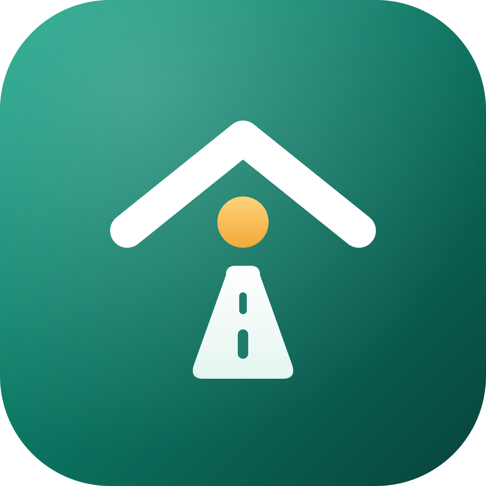
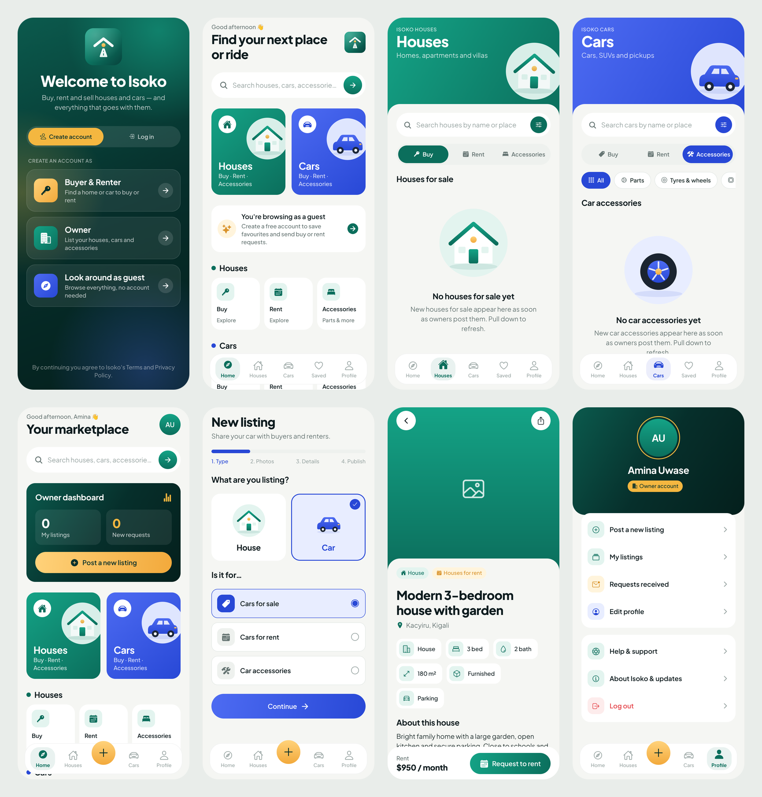

# Isoko

**Houses & cars, one marketplace.** Buy, rent and sell houses and cars — and the accessories that go with them — on iPhone and Android.



The logo: a roof (houses) above a road (cars). Together they form the letter **i**, with the gold window as its dot.



---

## What's inside

- **Welcome screen with 4 choices** — *Buyer & Renter*, *Owner*, *Broker*, or *Look around as guest*. The same choices appear when you switch to *Log in*. Brokers post and manage listings for their clients.
- **Houses and Cars are completely separate.** Each has its own tab, colour (green for houses, blue for cars) and three sections: **Buy · Rent · Accessories**. Accessories have their own types (Furniture, Appliances… / Parts, Tyres & wheels…).
- **Owners** post a listing in 4 steps (type → photos → details → publish), manage their listings (mark sold/rented, hide, delete) and accept or decline requests.
- **Buyers & renters** browse, search, save favourites, and send buy or rent requests (with start date and duration for rentals). The owner's phone number is shared only after they accept.
- **Guests** can browse everything; when they try to save or request, they're invited to sign up.
- **Three languages:** English, Français and Ikinyarwanda — switch any time with the 🌐 button or Profile → Language.
- **Messages:** buyers and renters chat live with owners inside the app, with an unread badge.
- **WhatsApp:** owners can let people contact them on WhatsApp with one tap.
- **Search filters:** price range, location, bedrooms, bathrooms, property type, furnished, parking, car year, fuel, gearbox, and sorting by price.
- **Premium listings:** owners and brokers can advertise — Premium listings show first, in a gold "Premium" row on Home.
- **Google Maps:** pin the exact spot when posting; every listing has "Open map" and "Directions".
- **Animations on every screen:** animated logo intro, floating background glows, sliding tab highlight with bouncing icons, cards that spring in one after another, parallax photos, heart "pop", shimmer loaders, animated progress bar in the posting wizard, success animations.
- **No screen ever looks empty.** Until owners post, each list shows a friendly animated illustration with a clear next step.

## Start in 3 commands

```bash
npm install
cp .env.example .env      # then add your Supabase keys (docs/03-BACKEND-SETUP.md)
npm start                 # scan the QR code with your phone
```

Without the `.env` keys the app still opens and you can look around the whole design as a guest.

## Guides

| Guide | What it's for |
|---|---|
| [docs/01-GETTING-STARTED.md](docs/01-GETTING-STARTED.md) | Install the tools and see the app on your phone |
| [docs/02-PROJECT-STRUCTURE.md](docs/02-PROJECT-STRUCTURE.md) | What every folder and file does |
| [docs/03-BACKEND-SETUP.md](docs/03-BACKEND-SETUP.md) | Set up the free database, logins and photo storage |
| [docs/04-DESIGN-SYSTEM.md](docs/04-DESIGN-SYSTEM.md) | Colours, fonts, animations, logo |
| [docs/05-PUBLISHING.md](docs/05-PUBLISHING.md) | Put Isoko in the App Store and Google Play |
| [docs/06-LANGUAGES.md](docs/06-LANGUAGES.md) | Change texts, or add a language |
| [docs/07-MESSAGES-AND-WHATSAPP.md](docs/07-MESSAGES-AND-WHATSAPP.md) | How chat and WhatsApp work |
| [docs/08-BROKERS-PREMIUM-MAPS.md](docs/08-BROKERS-PREMIUM-MAPS.md) | Brokers, filters, Premium (and how to switch it on), Google Maps |
| **[updates/README.md](updates/README.md)** | **How to change something and send a new update** |

## Built with

Expo SDK 58 · React Native · TypeScript · Expo Router · Reanimated · Supabase (database, login, photo storage) · EAS (cloud builds and over-the-air updates).
